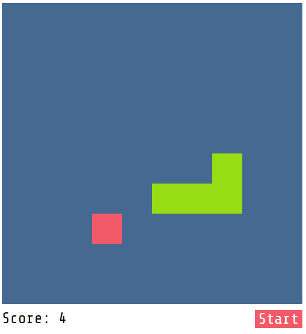

# Snake Game

A classic Snake game built with JavaScript, HTML, and CSS. Control the snake, collect food, increase your score, and try to avoid collisions.

## Screenshot



## Features

- Classic Snake gameplay.
- Keyboard controls using arrow keys.
- Score tracking.
- Random food generation.
- Collision detection.
- Game Over screen.

## Technologies

- HTML5
- CSS3
- JavaScript

## Getting Started

### Run Locally

1. Clone the repository:

   ```bash
   git clone https://github.com/Facundo-Reynoso/snake.git
   ```

2. Open the project folder.
3. Open `index.html` in your browser.

## Project Structure

```text
snake/
├── assets/
│   └── snake-screenshot.png
├── index.html
├── script.js
├── styles.css
└── README.md
```

## About

This project was developed as a practice project to improve my JavaScript skills and understand game logic, DOM manipulation, and event handling.
